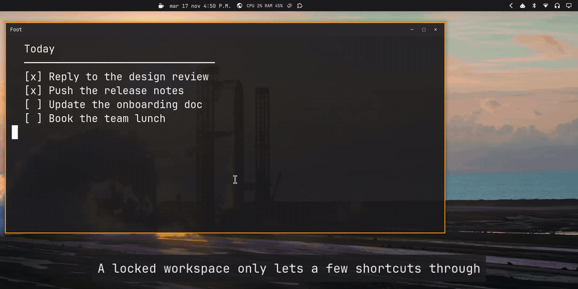
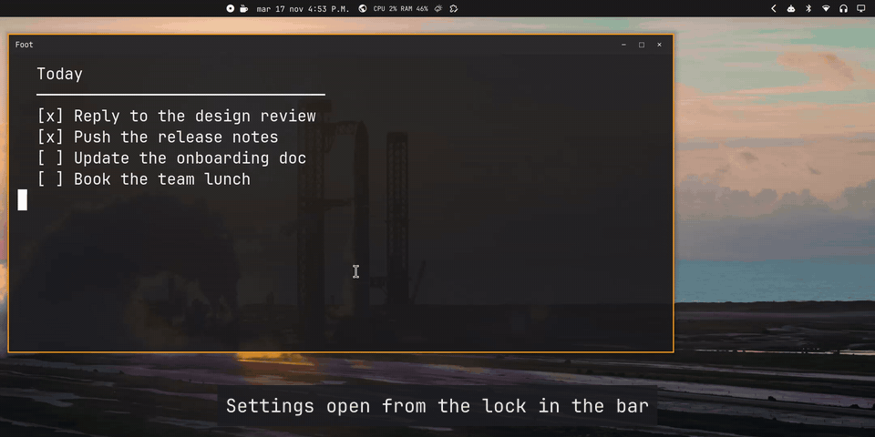

<p align="center"></p>

# Super Workspace Lock

Private workspaces for the Omarchy shell. Mark a workspace as private and, as soon as you
leave it, it locks: the next time you come back it is covered with a heavy blur and asks for
your password before it shows anything. Your system password always works, and each
workspace can also have a password of its own.

**Status: v0.3.2.** Lock right away or after some time away, the system password or a
per-workspace one, a lock icon in the bar, a settings window you can drive with the keyboard,
a shortcut to lock the workspace you are on, and a lock that comes back when the whole session
is locked.

## See it

**Only a few shortcuts get past the lock.** While a workspace is locked, the keyboard belongs to
the password card: Super+Q does not close the window behind the blur and Alt+Tab does not move the
focus, but Super+3 still takes you to another workspace.



**Everything is set in one window, from the keyboard.** Open it from the lock icon in the bar:
every workspace is a small monitor with its options beside it; Enter goes into them, left and right
change a value (here, locking after some time away), Esc goes back, and the General tab holds the
defaults every workspace inherits.



**A workspace can have a password of its own.** Type it twice in the settings and it is kept only
as a scrypt hash. Then Super+Ctrl+Shift+L locks the workspace you are on, and that password opens
it (your system password would too).


## What it does

- **Private workspaces.** Turn the switch on for a workspace (in the bar panel or in the
  settings). Nothing happens while you are on it; it locks when you leave it, so the next visit
  asks for the password first.
- **Lock right away, or after a while.** By default a private workspace locks the moment you
  leave it. You can give it some time away instead (5 seconds to 1 hour): come back sooner and it
  is still open.
- **A heavy blur, not a black screen.** The locked workspace stays exactly as it was (no window
  is moved or closed); it is shown behind a strong blur with a password card on top. The blur is
  Hyprland's own, turned on only while a workspace is locked and put back to your settings when
  it opens.
- **Nothing shows while you switch to it.** While a workspace is locked its windows are made fully
  transparent, so not even Hyprland's switch animation gives a glimpse of them. Opening it gives
  every window back its exact opacity.
- **Your password, or one of its own.** The system password (through PAM, the same check as
  Omarchy's lock screen) always opens a workspace. A workspace can also have its own password,
  kept only as a scrypt hash. The plugin never stores, logs or keeps your system password.
- **The keyboard stays out of the locked workspace.** What you type goes to the password card,
  and only a short list of shortcuts works while the blur is up: switching workspaces
  (Super+1…0, Super+Tab), the Omarchy menu (Super+Space) and the session lock (Super+Ctrl+L).
  Closing windows, Alt+Tab and every other shortcut wait until it is open. The list is yours to
  change in the settings.
- **Lock the workspace you are on.** Super+Ctrl+Shift+L locks it right now. On a public workspace
  that is a one-off lock: after you open it, it is public again. The shortcut can be changed in
  the settings by pressing the new one.
- **Locks again with the session.** When the whole session is locked (Omarchy's lock screen,
  LockSigil, or the idle lock), every private workspace you had opened locks again.
- **A lock icon in the bar.** It sits in the tray drawer, next to Bluetooth and Wi-Fi. Its panel
  lists your workspaces with their state, a private switch for each one, a lock-now button for the
  open private ones, and the way into the settings.
- **A settings window you can drive with the keyboard.** Two tabs: *Workspaces* (each one as a
  small monitor, its options beside it) and *General* (the defaults every workspace inherits).
  Arrows move, Enter goes into the options, left and right change a value, Esc goes back.
- **Too many wrong passwords** wait the same 120 seconds as Omarchy's lock screen (it is the same
  `faillock` rule), and the card tells you how long.
- **Never traps you.** If the shell stops while a workspace is locked, the plugin gives Hyprland
  back its shortcuts and blur on its own.
- English and Spanish, following Omarchy's language.

## Install

```bash
omarchy plugin add https://github.com/LeninZapata/omarchy-super-workspace-lock.git --enable
omarchy bar move leninzapata.super-workspace-lock --section tray
```

The second line puts the lock icon in the tray drawer (any other bar section works too). Then
open the panel, turn on **private** for a workspace, and leave it.

### Uninstall

```bash
omarchy plugin remove leninzapata.super-workspace-lock
```

Your settings and per-workspace passwords are kept, so a reinstall picks them up. To erase them:

```bash
rm -rf ~/.config/omarchy/super-workspace-lock
```

### Requirements

Omarchy 4.5 or newer with Hyprland 0.56 (Lua config), and `python3` for the per-workspace
password hashes. Everything else ships with Omarchy.

## Settings

Everything can be changed in the settings window (lock icon → **Settings**). The defaults in the
*General* tab apply to every workspace left on **Default**:

| Setting | Default | |
|---|---|---|
| When to lock | As soon as I leave | or after some time away (5 s – 1 h) |
| Password | System password | or the workspace's own password (the system one still works) |
| Lock shortcut | `Super+Ctrl+Shift+L` | press a new one to change it |
| Shortcuts on a locked workspace | `Super+1…0`, `Super+Tab`, `Super+Space`, `Super+Ctrl+L` | add or remove any; red ones are not in Omarchy's keybindings |

## Data

| Path | What |
|---|---|
| `~/.config/omarchy/super-workspace-lock/settings.json` | settings and which workspaces are private |
| `~/.config/omarchy/super-workspace-lock/passwords.json` | per-workspace passwords, as scrypt hashes |
| `~/.local/state/omarchy/super-workspace-lock/hidden.json` | the original opacity of windows hidden while their workspace is locked |

The folders are owner-only (`700`, files `600`), enforced at every shell start. Whether a workspace
is locked is never saved: after a restart every private workspace starts locked.

## Known limits

This is visual, personal privacy: it keeps what is on a workspace away from someone looking at
your screen. It does not hide the windows from tools running on your own account:

- the dock, window switchers (omahop and others), screenshots, screen sharing and
  `hyprctl clients` can still show or list the windows of a locked workspace;
- one monitor is supported; on a second monitor a locked workspace is not covered;
- no fingerprint unlock yet.

## Scripting

```bash
omarchy-shell leninzapata.super-workspace-lock state                # JSON: private, locked, …
omarchy-shell leninzapata.super-workspace-lock setPrivate 2 true    # make workspace 2 private
omarchy-shell leninzapata.super-workspace-lock lockCurrent          # lock the workspace you are on
omarchy-shell leninzapata.super-workspace-lock openSettings
```

## Changelog

What changed in each version is in [changelog.md](changelog.md).

## Development

```
├── manifest.json        # plugin manifest: a service and a bar widget
├── Service.qml          # settings, lock state, Hyprland events, session lock, IPC
├── Core.js              # pure lock state machine
├── Settings.js          # defaults and validation of settings.json
├── Gate.js              # the Lua sent to Hyprland: blur, allowed-shortcut submap, recovery
├── LockLayer.qml        # the blur layer and the password card
├── PasswordField.qml    # the plugin's own password field (no native Qt input)
├── Auth.qml             # PAM, per-workspace passwords and faillock
├── BarWidget.qml        # the lock icon and its panel
├── SettingsWindow.qml   # the settings window
├── SettingCard.qml      # one setting row
├── WorkspaceIcon.qml    # the small monitor
├── hash.py              # per-workspace password hashes (scrypt, password read from stdin)
├── vis.py               # windows of a locked workspace go transparent, and back
├── i18n/                # en.json, es.json
└── tests/               # QML syntax, node and python tests
```

- Run the tests: `tests/run.sh`
- Validate the manifest: `omarchy plugin validate .`
- After editing, reload the shell: `omarchy restart shell`

## License

[MIT](LICENSE)
